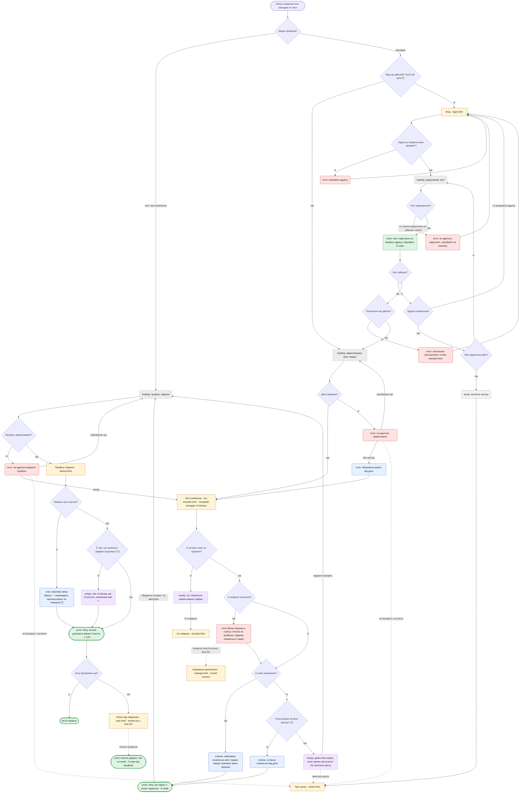
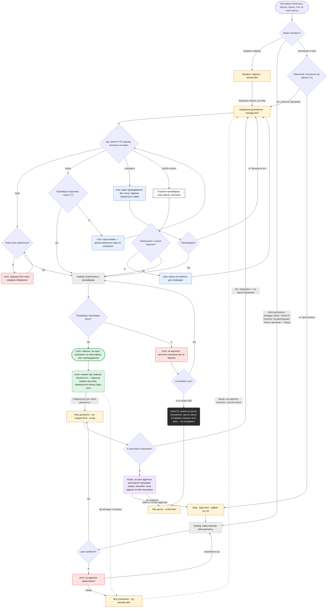
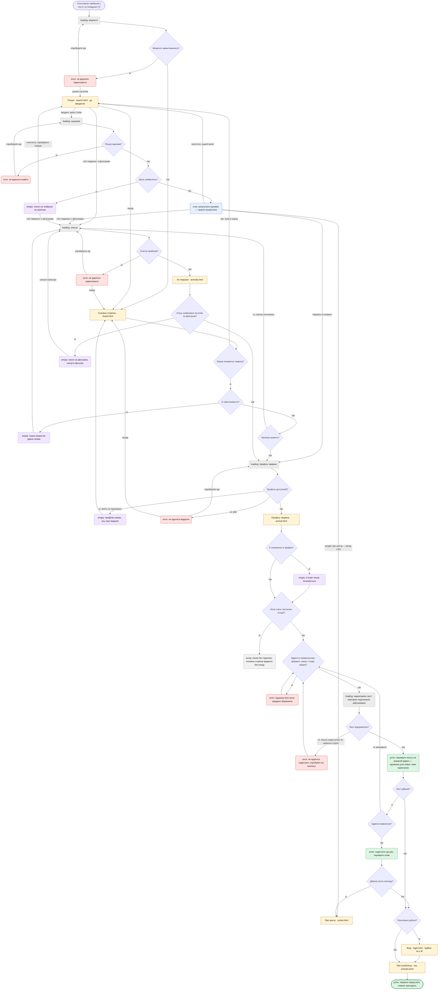
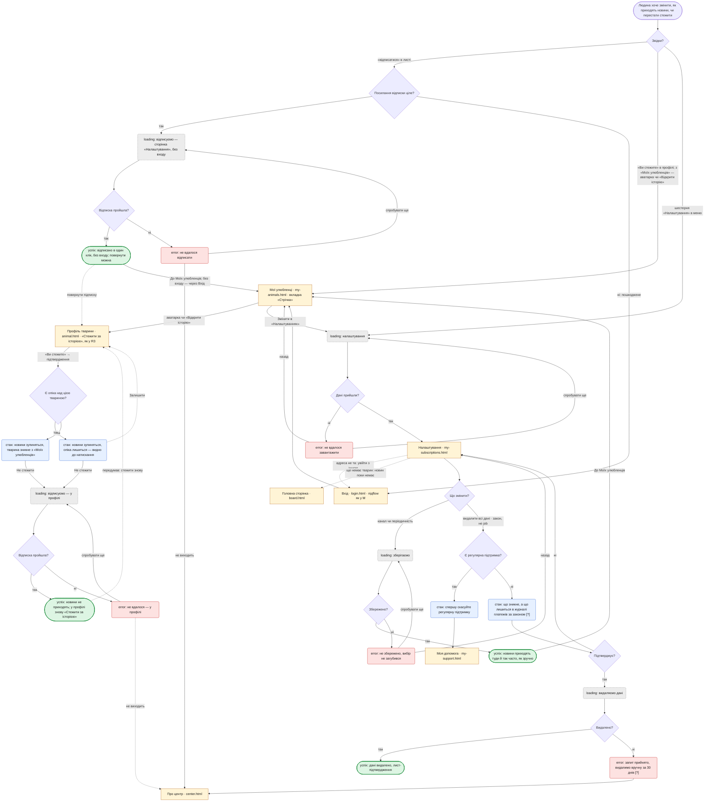
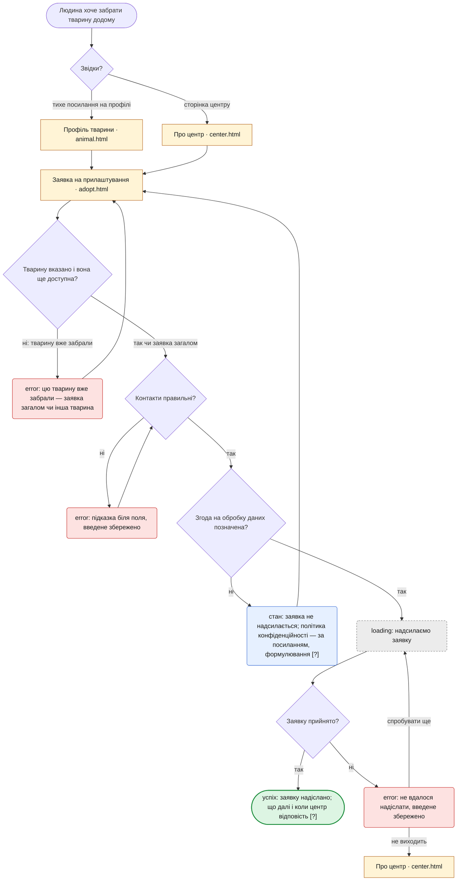
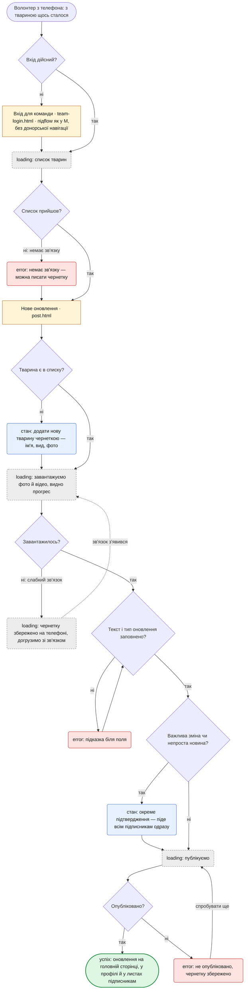

# User flows «Прайду»

*Чернетка від 13.11.2026; виправлено після критики того ж дня.* Екрани — з реєстру [sitemap.md](sitemap.md#екрани): назви вузлів беруться дослівно з колонки «Екран». Jobs — з [jtbd.md](jtbd.md), персони — з [personas.md](personas.md). Усі стани з flows є в колонці «Стани» [реєстру екранів](sitemap.md#екрани); варіанти базової сторінки — у [«Станах, а не екранах»](sitemap.md#стани-а-не-екрани).

**Як читати діаграми:**
- `[Екран · файл]` — прямокутник. Екран із реєстру sitemap.md.
- `{Питання?}` — ромб. Розвилка там, де дані можуть не прийти, введення може бути хибним або дія може не пройти.
- `(тип: стан)` — заокруглений вузол. Стан екрана, на якому людина зараз. Типи — ті самі, що в колонці «Стани» [sitemap.md](sitemap.md#екрани): **loading**, **empty**, **error**, **успіх** (зелений, тонка рамка — успіх дії на екрані, job ще не обов'язково закрито). **стан** — варіант базової сторінки, а не стан (sitemap.md, [«Стани, а не екрани»](sitemap.md#стани-а-не-екрани)). Колір — за типом. *Типи вирівняно з sitemap.md 14.11.2026; логіку переходів не змінено.*
- `[[Провайдер]]` — подвійна рамка. Зовнішня сторінка, а не наш екран: оплата відбувається в провайдера, карткових даних у нас немає (бриф, «Платежі»).
- `([успіх])` — зелений кінець: job закрито.
- **З кожної помилки є вихід «контакти центру»** — телефон, email, години роботи й «Про центр» (`center.html`), за правилом `wireframes/_conventions.md`. На діаграмах цю стрілку не малюємо, щоб не дублювати; намальовано лише там, де контакти — єдиний чи головний вихід. *Рішення 14.11.2026.* Виняток — flow R4, екрани команди: замість контактів центру — відповідальний за сайт у команді [?] *(рішення 14.11.2026)*.
- **Сірий вузол — вихід.** Людина пішла сама або job закрити не вдалося, але є шлях далі чи назад.
- **Чорний вузол — тупик [?].** Виходу немає, поки центр чи провайдер не відповість на відкрите питання. Тупиків без [?] у flows немає.
- **[?]** — розвилка чи обіцянка спирається на припущення: відповідь залежить від провайдера чи центру.
- «підflow як у M» — вузол розгортається так само, як у flow M. Його розвилки й стани там.

Мітки на вузлах робочі, це не тексти інтерфейсу. Тексти візьмемо з `microcopy.md`, коли він з'явиться.

## Чому саме ці flows

| Flow | Чому |
|---|---|
| **M** · Допомогти конкретній тварині й бачити, що це змінює її життя | Main job. Малюємо від головного екрана, для Опікуна |
| **R2** · Почати допомагати, поки рішення ще «гаряче» — Опікун | Найризикованіший: гроші, провайдери, вебхук, лист (DV2, HP4) |
| **R2** · Почати допомагати, поки рішення ще «гаряче» — Терміновий донатор | `donate.html` — глобальний розділ меню і єдиний екран цієї персони. Тут же перевіряється роль `center.html` для [E3](jtbd.md#e3--вірити-що-мені-показують-правду) |
| **R5** · Змінити чи зупинити регулярну допомогу, коли змінюються обставини | Ризикований для довіри: гроші списуються далі (DV4, HP5) |
| **R3** · Познайомитися з твариною, перш ніж давати гроші | Найчастіший: вхід для кожного нового відвідувача |
| **Г2** · Отримувати новини там, де я буваю, і так часто, як зручно | Без нього «Налаштування» (`my-subscriptions.html`) не мали б жодного flow. Сюди ж — відписка в один клік, «Не стежити» на картці й видалення даних (GDPR) |
| **Г9** · Повідомити центр, що хочу взяти тварину додому | Без нього `adopt.html` не мав жодного flow |
| **R4** · Знати, як живе підопічний після підтримки — сторона команди | Звідки беруться оновлення. Без нього `post.html` не мав жодного flow |

**R1** входить у flow R3: головна сторінка, «Пошук» (лупа в шапці) і «Усі тварини». **R4** з боку донора — серцевина flow M.

---

## M · Допомогти конкретній тварині й бачити, що це змінює її життя

**Персона:** Опікун (primary). **Обставини:** опіку вже оформлено. Він повертається із закладки чи з листа про оновлення і хоче побачити, що з його твариною, а за бажанням — підтримати її ще. **Старт:** «Мої улюбленці» (вкладка «Стрічка») або лист. **Кінець:** людина бачить, як змінюється життя її тварини, і, якщо хоче, підтримує її знову.

**Розвилки:**
1. **Звідки прийшов?** З листа — одразу в профіль тварини: він публічний, вхід не потрібен. Із закладки — через перевірку входу.
2. **Вхід ще дійсний?** Сесія живе 90 днів [?]. Ні — `login.html`.
3. **Адреса в правильному форматі?** Ні — помилка біля поля.
4. **Лист відправлено?** Ні (пошта недоступна, забагато спроб) — помилка й повтор за хвилину.
5. **Лист дійшов?** Ні — перевірити, чи правильна адреса.
6. **Адреса правильна?** Ні — назад, виправити. Так — надіслати ще раз.
7. **Уже надсилали двічі?** Так — вихід у контакти центру, а не нескінченна петля.
8. **Посилання ще дійсне?** Ні — назад на `login.html`.
9. **Дані прийшли?** Ні — повтор або, без зв'язку, збережена версія з датою. Не виходить — контакти центру.
10. **Є активні опіки чи підписки?** Ні — порожній головний: «Тут з'являться новини ваших тварин» і шлях в «Усі тварини». Людину без тварин, але з регулярним донатом, серце й меню ведуть одразу на вкладку «Моя допомога» (`my-support.html`) *(рішення 15.11.2026)*.
11. **Є невдале списання?** Так — банер першим у стрічці «Моїх улюбленців». Новини при цьому видно, flow не обривається. Банер веде в R5 — одразу на спосіб оплати (`manage-method.html`).
12. **Є нове оновлення?** Ні — останнє з датою.
13. **Тиша довша за ритм центру? [?]** Так — empty з виходами: «запитати центр» і «відкрити профіль». Ритм — вимога до `post.html` (нагадування волонтерам).
14. **Профіль завантажився?** Ні — повтор, назад або контакти центру.
15. **Тварина ще в центрі?** Ні — важлива зміна зверху профілю (DS5).
16. **Є звіт, що зроблено завдяки підтримці? [?]** Ні — empty, оновлення вже є.
17. **Хочу підтримати ще?** Ні — job закрито. Так — «Підтримати ще» в профілі → `care.html`; оплата з усіма розвилками — у flow R2. У стрічці «Моїх улюбленців» кнопки «Підтримати» немає — без тиску (15.11.2026; sitemap.md, «Глибина до main job»: 4 кліки від головного, 3 від профілю).

**Стани:**
- **loading:** надсилаємо лист (`login.html`); завантажуємо моїх тварин (`my-animals.html`); профіль тварини (`animal.html`).
- **empty:**
  - тут з'являться новини ваших тварин (`my-animals.html`);
  - давно без новин (`my-animals.html`);
  - звіт за місяць ще готується (`animal.html`).
- **error:**
  - хибна адреса; не вдалося надіслати; посилання прострочене (`login.html`);
  - не вдалося завантажити (`my-animals.html`, `animal.html`);
  - банер «не вдалося списати» першим у стрічці (`my-animals.html`).
- **успіх дії:** лист надіслано на адресу (`login.html`).
- **варіанти сторінки:** збережена версія від дати; стрічка зі свіжим оновленням; останнє оновлення від дати; тварини є, новин ще немає (`my-animals.html`); тварина вибула (`animal.html`).
- **успіх:** 0 кліків — найновіше оновлення моїх тварин на головному; 1 клік — профіль; 4 кліки від головного (3 від профілю) — внесок додано.
- **виходи:** контакти центру після двох невдалих листів і з помилок завантаження.
- **тупики:** немає.

---

## R2 · Почати допомагати, поки рішення ще «гаряче» — Опікун

**Персона:** Опікун (primary), перша опіка. **Обставини:** Опікун без входу — без акаунта й без пароля. Тварину вже знає з головної сторінки, рішення прийняте. **Старт:** профіль тварини. **Кінець:** опіку оформлено, тварина вже в «Моїх улюбленцях».

```mermaid
flowchart TD
    S(["Опікун без входу познайомився з твариною і вирішив допомогти"]) --> PROF["Профіль тварини · animal.html"]
    PROF --> Q1{"Тварина ще потребує опіки?"}
    Q1 -->|"ні: вибула [?]"| ST1("стан: опіка недоступна, можна стежити чи обрати іншу")
    ST1 --> BOARD["Головна сторінка · board.html"]
    Q1 -->|так| Q1B{"Уже опікується цією твариною?"}
    Q1B -->|"так, якщо увійшов"| ST1B("стан: ви вже опікуєтесь — змінити суму чи додати разовий внесок")
    ST1B -.->|"змінити суму"| SUP["Керування допомогою · manage.html · змінити суму"]
    ST1B -->|"разовий внесок"| CARE
    Q1B -->|ні| CARE["Опіка над твариною · care.html"]

    CARE --> Q2{"Режим, сума й адреса правильні? Дефолти вже обрано"}
    Q2 -->|ні| E1("error: підказка біля поля, введене збережено")
    E1 --> CARE
    Q2 -->|так| Q3{"Згода з умовами позначена?"}
    Q3 -->|ні| ST2("стан: оплата неактивна; умови відкриваються шторкою на цьому ж екрані")
    ST2 --> CARE
    Q3 -->|так| Q3B{"Попередня оплата ще обробляється?"}
    Q3B -->|так| ST2B("loading: повторна оплата заблокована, чекаємо підтвердження")
    ST2B --> L1
    Q3B -->|ні| L0("loading: переходимо до провайдера")
    L0 --> Q4{"Обраний спосіб?"}
    Q4 -->|"картка в гривні, Apple Pay, Google Pay"| UA[["WayForPay чи LiqPay, зовнішня"]]
    Q4 -->|"іноземна картка, USD чи EUR"| STR[["Stripe, зовнішня"]]

    UA --> Q5{"Повернувся з результатом?"}
    STR --> Q5
    Q5 -->|"ні: закрив вкладку чи скасував"| ST3("error: оплату не завершено, дані збережено")
    ST3 --> CARE
    Q5 -->|так| Q6{"Оплата пройшла?"}
    Q6 -->|ні| E2("error: оплату відхилено, спробуйте інший спосіб")
    E2 --> Q7{"Спробує ще?"}
    Q7 -->|так| CARE
    Q7 -->|ні| X1("вихід: назад до тварини, введене збережено")
    X1 --> PROF
    Q6 -->|так| L1("loading: перевіряємо оплату")

    L1 --> Q8{"Провайдер підтвердив за хвилину?"}
    Q8 -->|так| OK1
    Q8 -->|ні| ST4("loading: оплата обробляється, напишемо листом")
    ST4 --> Q9{"Підтвердження прийшло протягом доби? [?]"}
    Q9 -->|так| OK1
    Q9 -->|ні| E3("error: не вдалося підтвердити; якщо гроші списано — повернемо [?]; лист і контакти")
    E3 --> CONTACT["Про центр · center.html"]

    OK1(["успіх на care.html: опіку оформлено, тварина в Моїх улюбленцях; чек і вхід — на вказану адресу"])
    OK1 --> Q10{"Адреса правильна?"}
    Q10 -->|"ні: помилка в адресі"| FIX("успіх: виправити адресу — лише в цій сесії, до першого входу")
    FIX --> OK1
    Q10 -->|так| Q11{"Лист дійшов?"}
    Q11 -->|ні| W2("успіх: надіслати ще раз, перевірте спам")
    W2 --> Q12{"Дійшов після повтору?"}
    Q12 -->|ні| CONTACT
    Q12 -->|так| Q13
    Q11 -->|так| Q13{"Посилання дійсне?"}
    Q13 -->|ні| LOGIN["Вхід · login.html · підflow як у M"]
    LOGIN --> MAIN
    Q13 -->|так| MAIN["Мої улюбленці · my-animals.html"]
    MAIN --> DONE(["успіх: тварина серед моїх, без пароля"])
    classDef screen fill:#FFF4D6,stroke:#B5651D,color:#1a1a1a
    classDef loading fill:#ECECEC,stroke:#777777,color:#1a1a1a,stroke-dasharray:4 3
    classDef error fill:#FDE2E1,stroke:#C5221F,color:#1a1a1a
    classDef state fill:#E6F0FF,stroke:#3367D6,color:#1a1a1a
    classDef success fill:#DDF5E3,stroke:#1E8E3E,color:#1a1a1a
    classDef ok fill:#DDF5E3,stroke:#1E8E3E,color:#1a1a1a,stroke-width:2px
    classDef exit fill:#F2F2F2,stroke:#888888,color:#1a1a1a
    classDef ext fill:#FFFFFF,stroke:#555555,color:#1a1a1a
    class PROF,BOARD,SUP,CARE,CONTACT,LOGIN,MAIN screen
    class L0,L1,ST2B,ST4 loading
    class E1,E2,E3,ST3 error
    class ST1,ST1B,ST2 state
    class OK1,DONE ok
    class X1 exit
    class UA,STR ext
    class FIX,W2 success
```

**Розвилки:**
1. **Тварина ще потребує опіки?** Ні — опіка недоступна: можна стежити або перейти на головну сторінку.
2. **Уже опікується цією твариною?** Перевіряємо лише після входу. Так — змінити суму (`manage-amount.html`) чи додати разовий внесок.
3. **Режим, сума й адреса правильні?** Режим «щомісяця», сума й валюта (за мовою) вже обрані за замовчуванням. Ні — помилка біля поля, введене не губиться.
4. **Згода з умовами позначена?** Ні — кнопка оплати неактивна. Умови відкриваються шторкою на тому ж екрані, переходу на інший екран немає.
5. **Попередня оплата ще обробляється?** Так — повтор заблоковано, щоб не заплатити двічі.
6. **Обраний спосіб?** Картка в гривні (WayForPay чи LiqPay) або іноземна картка (Stripe). **Monobank-банки для опіки немає**, поки невідомо, чи прив'язується з неї платіж до опіки (питання до центру 4). Банка лишається на `donate.html`.
7. **Повернувся з результатом?** Ні — «оплату не завершено», дані збережено, людина знову на `care.html`.
8. **Оплата пройшла?** Ні — помилка.
9. **Спробує ще?** Ні — вихід назад до тварини, введене збережено.
10. **Провайдер підтвердив за хвилину?** Ні — «оплата обробляється».
11. **Підтвердження прийшло протягом доби? [?]** Ні — помилка: якщо гроші списано, повертаємо [?]. Лист і контакти.
12. **Адреса правильна?** Ні — виправити можна лише в цій же сесії, до першого входу: новий лист іде на нову адресу.
13. **Лист дійшов?** Ні — надіслати ще раз.
14. **Дійшов після повтору?** Ні — контакти центру.
15. **Посилання дійсне?** Ні — `login.html`, підflow як у M.

**Стани:**
- **loading:** переходимо до провайдера; перевіряємо оплату; повторна оплата заблокована; оплата обробляється (`care.html`).
- **empty:** немає — людина приходить у flow з обраною твариною.
- **error:** хибне поле; оплату не завершено; оплату відхилено; не вдалося підтвердити за добу (`care.html`).
- **успіх дії:** опіку оформлено; виправити адресу; надіслати ще раз (`care.html`).
- **варіанти сторінки:** опіка недоступна; ви вже опікуєтесь (`animal.html`); оплата неактивна без згоди (`care.html`).
- **успіх:** опіку оформлено (`care.html`); тварина в «Моїх улюбленцях».
- **виходи:** назад до тварини після відмови; контакти після невдалого підтвердження чи листа.
- **тупики:** немає.

---

## R2 · Почати допомагати, поки рішення ще «гаряче» — Терміновий донатор

**Персона:** Терміновий донатор (secondary). **Обставини:** приходить за посиланням на збір або з пункту меню «Підтримати». Героя не обирає, реєструватися не хоче, найімовірніше дає разово. **Старт:** `donate.html`. **Кінець:** донат дано, чек на email, акаунт не потрібен.

```mermaid
flowchart TD
    S(["Терміновий донатор: посилання на збір чи пункт меню Підтримати"]) --> L1("loading: прогрес збору")
    L1 --> Q1{"Дані збору прийшли?"}
    Q1 -->|ні| E1("error: прогрес не показано, донат усе одно можна дати")
    E1 --> DON
    Q1 -->|так| DON["Донат центру · donate.html"]
    DON --> Q2{"Є відкритий збір? [?]"}
    Q2 -->|"ні чи збір закрито"| EM1("empty: відкритих зборів немає — донат центру загалом; звіт закритого збору")
    EM1 --> Q3
    Q2 -->|так| Q3{"Хоче перевірити, хто такі «Прайд»?"}
    Q3 -->|так| CENTER["Про центр · center.html"]
    CENTER -->|"назад, введене збережено"| Q4
    Q3 -->|ні| Q4{"Сума правильна, режим обрано?"}
    Q4 -->|ні| E2("error: підказка біля поля")
    E2 --> DON
    Q4 -->|так| Q5{"Згода з умовами позначена?"}
    Q5 -->|ні| ST1("стан: оплата неактивна; умови — шторкою")
    ST1 --> DON
    Q5 -->|так| Q5A{"Попередня оплата ще обробляється?"}
    Q5A -->|так| ST4("loading: повторна оплата заблокована, чекаємо підтвердження")
    ST4 --> L2
    Q5A -->|ні| L0("loading: переходимо до провайдера")
    L0 --> Q6{"Обраний спосіб?"}
    Q6 -->|"Monobank-банка, лише разово"| MB[["Monobank-банка, зовнішня"]]
    MB --> OKB(["успіх у Банці: донат дано, чек від Monobank; у нас платіж не видно [?]"])
    Q6 -->|"картка в гривні"| UA[["WayForPay чи LiqPay, зовнішня"]]
    Q6 -->|"іноземна картка"| STR[["Stripe, зовнішня"]]

    UA --> Q7{"Повернувся з результатом?"}
    STR --> Q7
    Q7 -->|ні| ST2("error: оплату не завершено, сума збережена")
    ST2 --> DON
    Q7 -->|так| Q8{"Оплата пройшла?"}
    Q8 -->|ні| E3("error: відхилено, спробуйте інший спосіб")
    E3 --> Q9{"Спробує ще?"}
    Q9 -->|так| DON
    Q9 -->|ні| X1("вихід: сума збережена, повернутися можна з пункту меню Підтримати")
    Q8 -->|так| L2("loading: перевіряємо оплату")
    L2 --> Q10{"Підтвердження прийшло за хвилину?"}
    Q10 -->|так| OK1
    Q10 -->|ні| ST3("loading: оплата обробляється, чек прийде листом")
    ST3 --> Q11{"Підтвердилось протягом доби? [?]"}
    Q11 -->|так| OK1
    Q11 -->|ні| E4("error: не вдалося підтвердити; якщо списано — повернемо [?]")
    E4 --> CONTACT["Про центр · center.html"]
    OK1(["успіх: дякуємо, чек на email, без акаунта"])
    OK1 -.->|"регулярний: керування з посилання в чеку"| SUP["Керування допомогою · manage.html"]
    classDef screen fill:#FFF4D6,stroke:#B5651D,color:#1a1a1a
    classDef loading fill:#ECECEC,stroke:#777777,color:#1a1a1a,stroke-dasharray:4 3
    classDef empty fill:#F1E6FF,stroke:#7B3FB5,color:#1a1a1a,stroke-dasharray:4 3
    classDef error fill:#FDE2E1,stroke:#C5221F,color:#1a1a1a
    classDef state fill:#E6F0FF,stroke:#3367D6,color:#1a1a1a
    classDef ok fill:#DDF5E3,stroke:#1E8E3E,color:#1a1a1a,stroke-width:2px
    classDef exit fill:#F2F2F2,stroke:#888888,color:#1a1a1a
    classDef ext fill:#FFFFFF,stroke:#555555,color:#1a1a1a
    class DON,CENTER,CONTACT,SUP screen
    class L0,L1,L2,ST3,ST4 loading
    class EM1 empty
    class E1,E2,E3,E4,ST2 error
    class ST1 state
    class OKB,OK1 ok
    class X1 exit
    class MB,UA,STR ext
```

**Розвилки:**
1. **Дані збору прийшли?** Ні — прогрес не показано, але донат дати можна: збій не блокує оплату.
2. **Є відкритий збір? [?]** Ні або збір закрито — донат центру загалом і звіт закритого збору.
3. **Хоче перевірити, хто такі «Прайд»?** Так — `center.html` і назад, введене збережено. Це крок [E3](jtbd.md#e3--вірити-що-мені-показують-правду).
4. **Сума правильна, режим обрано?** Ні — помилка біля поля.
5. **Згода з умовами позначена?** Ні — оплата неактивна, умови — шторкою.
5а. **Попередня оплата ще обробляється?** Так — повтор заблоковано, щоб не заплатити двічі, і чекаємо підтвердження. Ні — «переходимо до провайдера». *Додано 13.11.2026, як у flow Опікуна.*
6. **Обраний спосіб?** Monobank-банка (лише разово: регулярних платежів у Банки немає), картка в гривні або іноземна картка.
7. **Повернувся з результатом?** Ні — «оплату не завершено», сума збережена.
8. **Оплата пройшла?** Ні — помилка.
9. **Спробує ще?** Ні — вихід, сума збережена.
10. **Підтвердження прийшло за хвилину?** Ні — «оплата обробляється».
11. **Підтвердилось протягом доби? [?]** Ні — помилка, повернення коштів [?], контакти.

**Стани:**
- **loading:** прогрес збору; переходимо до провайдера; перевіряємо оплату; повторна оплата заблокована; оплата обробляється (`donate.html`).
- **empty:** відкритих зборів немає; збір закрито — звіт (`donate.html`).
- **error:** прогрес не показано; хибна сума; оплату не завершено; відхилено; не підтверджено за добу (`donate.html`).
- **варіанти сторінки:** оплата неактивна без згоди; Monobank-банка лише разово (`donate.html`).
- **успіх:** чек на email без акаунта; у Банці — чек від Monobank [?].
- **виходи:** сума збережена після відмови; контакти після невдалого підтвердження.
- **тупики:** немає.

---

## R5 · Змінити чи зупинити регулярну допомогу, коли змінюються обставини

**Персона:** Опікун (primary). **Обставини:** опіка регулярна, а в житті щось змінилося. Він хоче зменшити суму, поставити на паузу, скасувати чи змінити картку — без пояснень і без провини. **Старт:** профіль тварини («Керувати опікою» — одразу «Керування допомогою» цієї опіки), вкладка чи пункт меню «Моя допомога» (огляд → «Керувати ›»), банер «не вдалося списати» у стрічці «Моїх улюбленців», посилання в чеку. *15.11.2026: на «Моїх улюбленцях» карток із «Керувати опікою» більше немає — там стрічка новин.* *Перебудовано 15.11.2026: «Моя допомога» — огляд, зміни — на окремому екрані «Керування допомогою», одне рішення на вигляд.* **Кінець:** зміну підтвердив провайдер, наступне списання вже інше.

**Розвилки:**
1. **Звідки заходить?** Профіль тварини («Керувати опікою» — одразу `manage.html` цієї опіки); вкладка чи пункт меню «Моя допомога», посилання «Опіка й платежі» під аватарками на «Моїх улюбленцях»; банер «не вдалося списати» — одразу на спосіб оплати; донатора без тварин серце й меню ведуть на «Мою допомогу» одразу; посилання в чеку *(рішення 15.11.2026)*.
2. **Підписане посилання ще дійсне? [?]** Посилання в чеку відкриває саме цю опіку чи донат на `manage.html` без входу. Воно стосується лише цієї підтримки і має строк дії [?]. Ні — `login.html`.
3. **Дані прийшли?** Ні — повтор або назад.
4. **Є регулярна підтримка?** Ні — empty з поясненням і двома виходами: увійти з іншою адресою або контакти. Так — огляд «Щомісяця ви даєте…» з картками; «Керувати ›» → `manage.html`.
5. **Що змінити?** На екрані «Керування допомогою» — рядки «Змінити суму», «Призупинити» [?], «Змінити спосіб оплати», під рискою «Скасувати опіку». Кожен веде на свій вигляд з одним рішенням: `manage-amount.html`, `manage-pause.html`, `manage-method.html`, `manage-cancel.html` *(рішення 15.11.2026)*.
6. **Нова сума правильна?** Готові суми як на `care.html` або «Інша сума» з цифровою клавіатурою. Ні — помилка біля поля, введене збережено.
7. **Провайдер підтримує паузу? [?]** Ні — чесно кажемо, що паузи немає, і пропонуємо зменшити суму чи скасувати.
8. **Підтверджує скасування?** Одне підтвердження без тиску: дві однаково світлі кнопки «Скасувати опіку» і «Залишити як є». Ні — назад на `manage.html` без змін.
9. **Повернувся з новою карткою?** Ні — діє попередня картка.
10. **Провайдер підтвердив зміну?** Ні — помилка: наступне списання ще не змінено.
11. **Спробувати ще?** «Ні чи знову збій» — заявка на ручне скасування з поверненням списаного. **Це тупик [?]**, поки центр не погодить таку гарантію (питання до центру 6).

**Стани:**
- **loading:** завантажуємо мою допомогу (`my-support.html`); оновлюємо в провайдера (`manage.html`).
- **empty:** регулярної підтримки за цією адресою немає (`my-support.html`).
- **error:** не вдалося завантажити (`my-support.html`); хибна сума — біля поля (`manage-amount.html`); провайдер не підтвердив зміну; заявка на ручне скасування [?] (`manage.html`).
- **успіх дії:** змінено, на паузі, скасовано чи нова картка — тут і листом; новини про тварину лишаються (`manage.html`).
- **варіанти сторінки:** змінити суму, призупинити, спосіб оплати, скасувати (`manage-*.html`); паузи немає; картку не змінено; не вдалося списати (`manage.html`).
- **виходи:** увійти з іншою адресою; контакти; з успіху — «Повернутися до „Моєї допомоги“».
- **тупики:** провайдер раз за разом не приймає зміну [?] — закриється, коли центр погодить ручне скасування.

---

## R3 · Познайомитися з твариною, перш ніж давати гроші

**Персона:** Спостерігач (secondary). **Обставини:** приходить без наміру платити, щоб подивитися на тварин [?]. Акаунта немає. **Старт:** головна сторінка. **Кінець:** людина побачила, як живе тварина, і стала частиною її історії — підписалася. Платити вона не мусить.

**Розвилки:**
1. **Моменти завантажились?** Ні — повтор або «шукати за ім'ям» → «Пошук».
2. **Шукає конкретну тварину?** Так — лупа в шапці відкриває «Пошук» (`search.html`): окрему сторінку «чисто під пошук», без шапки сайту, з курсором у порожньому полі *(рішення 15.11.2026)*. Людина вводить запит і натискає Enter — кнопки «Знайти» немає; поки шукаємо — «шукаємо». «‹ Назад» повертає на попередній екран. Поля пошуку на головній сторінці немає: пошук глобальний, з будь-якого екрана донора, а перший екран головної сторінки віддано моментам *(рішення 14.11.2026)*. На клавіатурі в тілі головної сторінки першим іде «пропустити стрічку».
2а. **Пошук відповів?** Ні — «не вдалося знайти», запит збережено → спробувати ще.
2б. **Щось знайшлось?** Так — результати групами, тварини першими (`search-results.html` — варіант базової сторінки, а не стан): тварина чи момент → профіль (L2); «Усі тварини» — переглядати з фільтрами; розділ про центр → `center.html` — це вихід з R3, а не його крок; «×» очищає поле — назад до `search.html`. Ні — empty «нічого не знайшли за запитом»: виправити запит чи очистити й спробувати інакше, «Усі тварини» з фільтрами.
3. **Є свіжі моменти?** Ні — empty, шлях в «Усі тварини».
4. **Зачепив момент?** Так — профіль. Стрічка скінчилась — «Усі тварини».
4а. **Список прийшов?** «Усі тварини» вантажаться окремо: ні — помилка з повтором чи назад на головну сторінку. *Додано 13.11.2026 за sitemap.md і сторінками.*
5. **Хтось знайшовся за ім'ям чи фільтром?** Ім'я й фільтри — фільтри списку «Усі тварини», а не глобальний пошук. Ні — empty зі скиданням фільтрів.
6. **Профіль доступний?** Знято чи приховано — empty з іншими тваринами. Збій — повтор або назад.
7. **Є оновлення в профілі?** Ні — «історія тільки починається».
8. **Хоче стати частиною історії?** Ні — вихід: головна сторінка відкрита без входу, повернутися можна будь-коли.
9. **Адреса в правильному форматі, канал і згода обрані?** Ні — помилка біля поля, введене збережено. Форма коротка: періодичності в ній немає — новини йдуть за замовчуванням [?], змінити можна в «Налаштуваннях» *(рішення 14.11.2026)*.
9а. **Лист відправлено?** Як у вході: поки лист іде — «Надсилаємо лист…», повторне надсилання заблоковано. Ні — «не вдалося надіслати, спробуйте за хвилину». «Надіслати ще раз» з розвилки 11 іде тим самим шляхом *(рішення 14.11.2026)*.
10. **Лист дійшов?** Стан «перевірте пошту» однаковий для нових і вже підписаних: інтерфейс не розкриває, чи підписана адреса. Тому, хто вже підписаний, лист пише «ви вже стежите».
11. **Адреса правильна?** Ні — виправити. Так — надіслати ще раз.
12. **Дійшов після повтору?** Ні — контакти.
13. **Посилання дійсне?** Ні — `login.html`.

**Стани:**
- **loading:** моменти (`board.html`); шукаємо (`search.html`); список (`animals.html`); профіль тварини; надсилаємо лист (`animal.html`).
- **empty:**
  - нових моментів давно немає (`board.html`);
  - нічого не знайшли за запитом (`search.html`);
  - нікого за фільтром (`animals.html`);
  - профілю немає; історія тільки починається (`animal.html`).
- **error:** не вдалося завантажити (`board.html`, `animals.html`); не вдалося знайти (`search.html`); не вдалося відкрити; хибна адреса; не вдалося надіслати лист (`animal.html`).
- **варіанти сторінки:** до введення — порожнє поле з курсором; результати групами — тварини, моменти, про центр (`search.html`, `search-results.html`).
- **успіх дії:** перевірте пошту; надіслати ще раз (`animal.html`).
- **успіх:** тварина в «Моїх улюбленцях», новини приходять.
- **виходи:** пішов без підписки; контакти після невдалого листа.
- **тупики:** немає.

---

## Г2 · Отримувати новини там, де я буваю, і так часто, як зручно

**Персони:** Опікун і Спостерігач. Г2 — гіпотеза [?]: даних про канали й частоту немає. **Обставини:** новин забагато чи замало, незручний канал, або людина хоче припинити. **Старт:** «відписатися» в листі, «Ви стежите» в профілі тварини або «Налаштування». **Кінець:** новини приходять туди й так часто, як зручно, або людина перестала стежити — в один клік із листа чи з профілю тварини. Видалення даних — вимога закону (GDPR), а не job, але воно живе в «Налаштуваннях». *Перебудовано 15.11.2026: «Мої улюбленці» — один розділ із вкладками; списку «За ким я стежу» більше немає. «Не стежити» — у профілі тварини, де й «Стежити за історією»: де підписався — там і відписуєшся (того ж дня, замість кнопки «Ще» на картці).*

**Розвилки:**
1. **Звідки?** «Відписатися» в листі (без входу), «Ви стежите» в профілі тварини (з «Моїх улюбленців» — аватарка чи «Відкрити історію») або «Налаштування» — окрема сторінка, не вкладка: шестерня в меню чи «Змінити в „Налаштуваннях“» на вкладці «Стрічка» *(рішення 15.11.2026)*.
2. **Посилання відписки ціле?** Посилання відписки не має строку дії: відписка в один клік. Пошкоджене — вхід, а далі «Ви стежите» → «Не стежити» в профілі тварини.
3. **Відписка пройшла?** Ні — повтор або контакти. Так — відписано; передумали — профіль тварини, «Стежити за історією», далі як у flow R3. *Рішення 14.11.2026.*
4. **Дані прийшли?** Ні — повтор або назад.
5. ~~**Є підписки?**~~ *Прибрано 15.11.2026:* списку підписок у «Налаштуваннях» немає, порожнього стану теж. Без жодної тварини «Налаштування» — варіант «новин поки немає» з шляхом на головну сторінку. На будь-якій сторінці «Налаштувань» є «Адреса не та? Увійти з іншою» → вхід; підписки й дані попередньої адреси не переносимо й не видаляємо *(рішення 14.11.2026)*.
6. **Що змінити?** Канал чи періодичність — у MVP одні на всіх тварин, окремо для кожної не налаштовуються *(рішення 14.11.2026; Г2 не підтверджена)*; видалення всіх даних. Відписки від однієї тварини тут немає — вона в профілі тварини (розвилки 11–12).
7. **Збережено?** Ні — помилка, вибір не загубився.
8. **Є регулярна підтримка?** Так — спершу скасувати її: «Моя допомога» (`my-support.html`) → «Керувати ›» → «Скасувати» (`manage-cancel.html`).
9. **Підтверджує видалення?** Перед підтвердженням показуємо, що зникне, а що лишиться в журналі платежів за законом [?].
10. **Видалено?** Ні — запит прийнято, видалимо вручну за 30 днів [?].
11. **Є опіка над цією твариною?** *15.11.2026.* У профілі «Ви стежите» відкриває одне підтвердження «Перестати стежити за [ім'я]?» з наслідками до натискання (`animal-following.html`). Так — новини зупиняться, а опіка й чеки лишаться: підписка окремо від опіки. Ні — тварина зникне з «Моїх улюбленців». Повернутися — «Стежити за історією» тут же. Дві однаково світлі кнопки «Не стежити» / «Залишити».
12. **Відписка з профілю пройшла?** Так — профіль оновлюється на місці: знову «Стежити за історією». Ні — під кнопками «не вдалося», спробувати ще; не виходить — контакти.

**Стани:**
- **loading:** відписуємо з листа; налаштування; зберігаємо; видаляємо дані (`my-subscriptions.html`); відписуємо — у профілі (`animal.html`).
- **empty:** немає — «Налаштування» не бувають порожніми (`my-subscriptions.html`).
- **error:** не вдалося відписати з листа; не вдалося завантажити; не збережено; видалення не пройшло (`my-subscriptions.html`); відписка з профілю не пройшла (`animal.html`).
- **варіанти сторінки:** спершу скасуйте підтримку; що зникне при видаленні; новин поки немає (`my-subscriptions.html`); «Ви стежите» з підтвердженням: новини зупиняться, опіка лишиться; тварина зникне з «Моїх улюбленців» (`animal-following.html`).
- **успіх:** відписано з листа — повернути підписку можна в профілі тварини; новини не приходять, у профілі знову «Стежити за історією»; новини приходять, як зручно; дані видалено.
- **тупики:** немає.

---

## Г9 · Повідомити центр, що хочу взяти тварину додому

**Персона:** жодна з трьох [?]. Г9 — гіпотеза з брифу (сценарій 6); прилаштування лишається за рішенням замовниці. **Старт:** тихе посилання «хочу забрати додому» на профілі тварини або сторінка центру. **Кінець:** заявку надіслано, людина знає, що буде далі.

**Розвилки:**
1. **Звідки?** З профілю тварини (заявка про неї) або зі сторінки центру (заявка загалом). Тихого посилання немає на профілі коня: коней не прилаштовують (від замовниці, 15.11.2026).
2. **Тварину вказано і вона ще доступна?** Ні — тварину вже забрали: заявка загалом або інша тварина.
3. **Контакти правильні?** Ні — помилка біля поля.
3а. **Згода на обробку даних позначена?** За замовчуванням — ні. Без згоди заявка не надсилається. Формулювання й політика — [?], погодити з центром. *Рішення 13.11.2026.*
4. **Заявку прийнято?** Ні — повтор або контакти.

**Стани:**
- **loading:** надсилаємо заявку (`adopt.html`).
- **empty:** немає — форма завжди порожня на старті, і це не стан відсутності даних.
- **error:** хибні контакти; тварину вже забрали; не вдалося надіслати (`adopt.html`).
- **варіанти сторінки:** заявка не надсилається без згоди на обробку даних (`adopt.html`).
- **успіх:** заявку надіслано, видно, що далі.
- **тупики:** немає.

---

## R4 · Знати, як живе підопічний після підтримки — сторона команди

**Хто:** волонтер центру — роль із брифу («1–3 волонтери з телефона»), а не персона з personas.md. Jobs команди ще не зібрано, тому flow підписано job донора, який він забезпечує. **Обставини:** телефон, нестабільний зв'язок, кілька хвилин між справами. **Старт:** `post.html`. **Кінець:** оновлення у стрічці, у профілі й у листах підписникам.

**Розвилки:**
1. **Вхід дійсний?** Ні — `team-login.html`: той самий вхід за посиланням із листа, що й `login.html`, але без меню, серця й лупи донора. Після «Надіслати» екран однаковий для будь-якої адреси — «Лист надіслано»: інтерфейс не розкриває, хто в команді. Лист іде лише на адреси зі списку команди. *Рішення 13–14.11.2026.*
2. **Список прийшов?** Ні — без зв'язку можна писати чернетку.
3. **Тварина є в списку?** Ні — додати нову тварину чернеткою (ім'я, вид, фото). Повний профіль редагується поза цим екраном [?] (див. sitemap.md, «Що свідомо не стало екраном»).
4. **Завантажилось?** Ні — чернетка зберігається на телефоні й догружається, коли з'явиться зв'язок.
5. **Текст і тип заповнено?** Ні — помилка біля поля.
6. **Важлива зміна чи непроста новина?** Так — окреме підтвердження: такі оновлення йдуть усім одразу, хоч яка періодичність (DS5).
7. **Опубліковано?** Ні — помилка, чернетку збережено.

**Стани:**
- **loading:** список тварин; фото й відео з прогресом; чернетку збережено на телефоні; публікуємо (`post.html`).
- **empty:** немає — тварини, про яких давно не писали, стоять зверху списку. Так команда закриває «тишу» з flow M.
- **error:** немає зв'язку; хибне поле; не опубліковано (`post.html`).
- **варіанти сторінки:** нова тварина чернеткою; підтвердження важливої зміни (`post.html`).
- **успіх:** оновлення опубліковано.
- **тупики:** немає.

---

## Що flows показали для продукту

- **Лист — головна точка відмови.** Він стоїть на шляху в M, обох R2, R3 і Г2. Тому на кожному стані «перевірте пошту» є адреса, дія «виправити адресу», «надіслати ще раз» і вихід у контакти після двох спроб.
- **Вебхук може запізнитися або не прийти.** На `care.html` і `donate.html` обов'язкові стани «оплата обробляється» і «не підтверджено за добу», а також блок повторної оплати.
- **Monobank-банка — лише для разового донату центру**, поки центр не відповість, чи прив'язується платіж до людини й тварини.
- **Лишився один тупик [?]** — R5, провайдер раз за разом не приймає скасування. Він закриється, коли центр погодить ручне скасування з поверненням.
- **Пошук — глобальний, а не частина стрічки** *(рішення 14.11.2026)*. Лупа в шапці кожного екрана донора веде в `search.html`: тварини, моменти, розділи про центр. Перший екран головної сторінки віддано моментам, а шлях до конкретної тварини лишився коротким — лупа, запит, тварина першою в результатах.
- **«Тишу» в M закриває команда, а не головний екран:** у `post.html` тварини без новин стоять зверху. На головному в цьому стані — empty з виходами.
